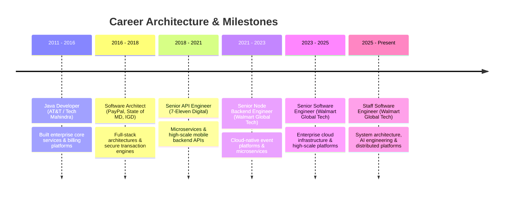

<!-- Header Banner -->

  

<!-- Quick Info & Badges -->

---

### 💫 About Me

**Staff Software Engineer & Software Architect** with **14+ years of experience** architecting high-throughput distributed systems, cloud-native backend platforms, and high-volume transaction engines across retail, financial services, and telecom. 

Currently building enterprise-scale platforms at **Walmart Global Tech** and actively engineering with **Generative AI, Agentic LLM Workflows, and Autonomous Systems**.

- 🔭 **Currently Working On**: High-scale distributed event streaming & enterprise cloud platforms
- 🧠 **Focus Areas**: Agentic AI Architectures, Large Language Models, Distributed Systems, Multi-Cloud Platforms
- 💼 **Domain Expertise**: Retail Tech, FinTech, High-Volume APIs, Distributed Event Streaming
- 📬 **Get In Touch**: Connect with me on [LinkedIn](https://www.linkedin.com/in/am368a)

---

### 📊 GitHub Activity & Stats

  
  

---

### 🛠️ Technical Ecosystem

| Domain | Technologies & Frameworks |
| :--- | :--- |
| **Languages** | `Python` `Java` `TypeScript` `JavaScript` `Rust` `Kotlin` `C` `C++` |
| **Backend & APIs** | `Node.js` `Spring Boot` `FastAPI` `GraphQL` `REST` `gRPC` `WebSockets` |
| **AI & LLMs** | `LangChain` `LlamaIndex` `PyTorch` `Vector DBs` `Agentic Workflows` `MCP` |
| **Cloud & Infra** | `AWS` `Kubernetes` `Docker` `Apache Kafka` `Serverless` `Terraform` |
| **Databases** | `PostgreSQL` `MongoDB` `Redis` `DynamoDB` `CosmosDB` |
| **Observability & CI/CD** | `Prometheus` `Grafana` `Splunk` `GitHub Actions` `GitLab CI` `Jenkins` |
| **Mobile & Web** | `Angular` `React Native` `Flutter` `Android (Kotlin)` |

---

### 💼 Professional Journey

---

### 🚀 Key Projects & Open Source

#### 🛠️ Open Source Utilities
- 📦 [**mongo-export-import**](https://github.com/am368a/mongo-export-import) — CLI utility wrapper for fast MongoDB dataset migration & exports *(JavaScript)*
- ⚡ [**serverless-websockets**](https://github.com/am368a/serverless-websockets) — Real-time event architecture using AWS API Gateway & Lambda *(JavaScript)*
- 🖼️ [**serverless-node-image**](https://github.com/am368a/serverless-node-image) — High-throughput image processing pipeline on AWS Serverless *(JavaScript)*

#### 🏢 Organization & Platform Work
- 🚛 [**suma-inc**](https://github.com/suma-inc) — Feonix fleet management & telemetry platform
- 🚕 [**igdinaction**](https://github.com/igdinaction) — Liberty Now transportation & dispatch platform
- 🤖 [**udacity-awm**](https://github.com/udacity-awm) — Agentic AI & Autonomous Systems engineering
- 📱 [**mcso-ap**](https://github.com/mcso-ap) — Mobile Computing & Android Platform development

---
